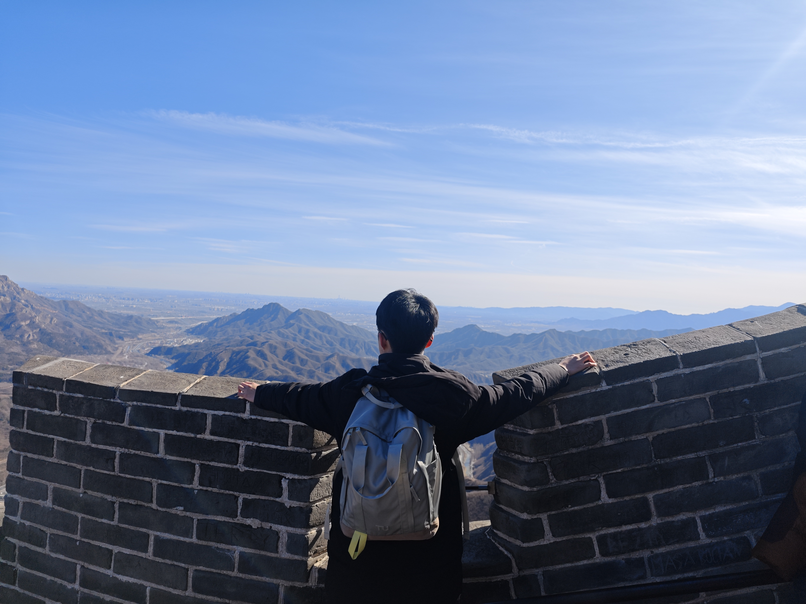
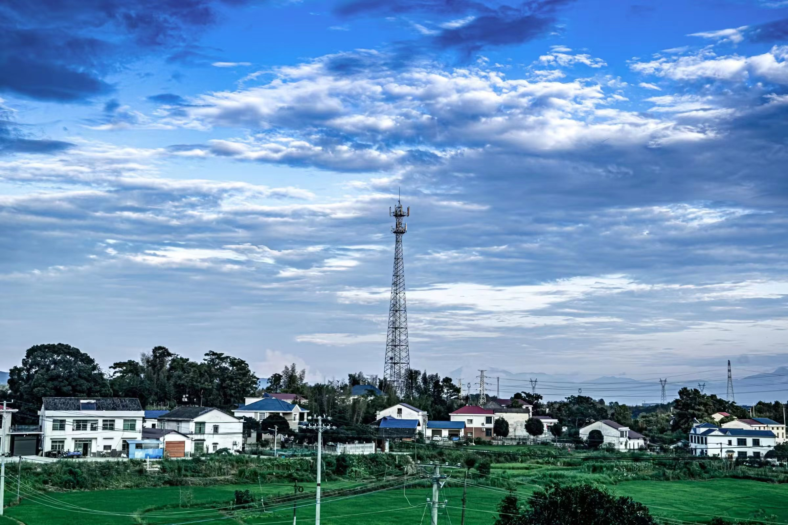

#

## Herbert Lu's profile

### personal Information

2023.09 - 2027.06 吉林大学 计算机科学与技术学院 本科

2026.01.04 - 2026.03.20 北京 途游游戏-平台中心 Golang-后端开发实习生

2026.04.22 - 2026.08.14 北京 字节跳动-国际支付 Golang-后端研发实习生

Hello, I am Herbert Lu.

故乡江苏南通，高中毕业于江苏省海门中学。自2025年暑假起，我开始系统性的学习 Java/Golang 后端开发，目前正在学习分布式系统和金融支付领域的业务知识。意向于2027届本科毕业后工作，在金融支付相关的研发领域作深入的学习。

<!-- <div align="center">
    
</div> -->

### Tech-Stacks & Tools

#### Programming Languages


#### Toolchains & Frameworks


#### Development tools & Environment


### My GitHub statistics

<div>
  
</div>

### My coding activities

<p>CodeTime Since 2025.12.15</p>
</img>

<!--START_SECTION:waka-->


**I'm a Night 🦉** 

```text
🌞 Morning                58 commits          ⣿⣀⣀⣀⣀⣀⣀⣀⣀⣀⣀⣀⣀⣀⣀⣀⣀⣀⣀⣀⣀⣀⣀⣀⣀   04.57 % 
🌆 Daytime                232 commits         ⣿⣿⣿⣿⣿⣀⣀⣀⣀⣀⣀⣀⣀⣀⣀⣀⣀⣀⣀⣀⣀⣀⣀⣀⣀   18.30 % 
🌃 Evening                893 commits         ⣿⣿⣿⣿⣿⣿⣿⣿⣿⣿⣿⣿⣿⣿⣿⣿⣿⣿⣀⣀⣀⣀⣀⣀⣀   70.43 % 
🌙 Night                  85 commits          ⣿⣿⣀⣀⣀⣀⣀⣀⣀⣀⣀⣀⣀⣀⣀⣀⣀⣀⣀⣀⣀⣀⣀⣀⣀   06.70 % 
```
📅 **I'm Most Productive on Monday** 

```text
Monday                   242 commits         ⣿⣿⣿⣿⣿⣀⣀⣀⣀⣀⣀⣀⣀⣀⣀⣀⣀⣀⣀⣀⣀⣀⣀⣀⣀   19.09 % 
Tuesday                  135 commits         ⣿⣿⣿⣀⣀⣀⣀⣀⣀⣀⣀⣀⣀⣀⣀⣀⣀⣀⣀⣀⣀⣀⣀⣀⣀   10.65 % 
Wednesday                144 commits         ⣿⣿⣿⣀⣀⣀⣀⣀⣀⣀⣀⣀⣀⣀⣀⣀⣀⣀⣀⣀⣀⣀⣀⣀⣀   11.36 % 
Thursday                 206 commits         ⣿⣿⣿⣿⣀⣀⣀⣀⣀⣀⣀⣀⣀⣀⣀⣀⣀⣀⣀⣀⣀⣀⣀⣀⣀   16.25 % 
Friday                   178 commits         ⣿⣿⣿⣿⣀⣀⣀⣀⣀⣀⣀⣀⣀⣀⣀⣀⣀⣀⣀⣀⣀⣀⣀⣀⣀   14.04 % 
Saturday                 156 commits         ⣿⣿⣿⣀⣀⣀⣀⣀⣀⣀⣀⣀⣀⣀⣀⣀⣀⣀⣀⣀⣀⣀⣀⣀⣀   12.30 % 
Sunday                   207 commits         ⣿⣿⣿⣿⣀⣀⣀⣀⣀⣀⣀⣀⣀⣀⣀⣀⣀⣀⣀⣀⣀⣀⣀⣀⣀   16.32 % 
```


📊 **This Week I Spent My Time On** 

```text
🕑︎ Time Zone: Asia/Shanghai

💬 Programming Languages: 
C++                      1 hr 29 mins        ⣿⣿⣿⣿⣿⣿⣿⣿⣿⣿⣿⣀⣀⣀⣀⣀⣀⣀⣀⣀⣀⣀⣀⣀⣀   42.59 % 
Markdown                 1 hr 6 mins         ⣿⣿⣿⣿⣿⣿⣿⣿⣀⣀⣀⣀⣀⣀⣀⣀⣀⣀⣀⣀⣀⣀⣀⣀⣀   31.49 % 
Python                   26 mins             ⣿⣿⣿⣀⣀⣀⣀⣀⣀⣀⣀⣀⣀⣀⣀⣀⣀⣀⣀⣀⣀⣀⣀⣀⣀   12.45 % 
Other                    20 mins             ⣿⣿⣀⣀⣀⣀⣀⣀⣀⣀⣀⣀⣀⣀⣀⣀⣀⣀⣀⣀⣀⣀⣀⣀⣀   09.68 % 
JSON                     8 mins              ⣿⣀⣀⣀⣀⣀⣀⣀⣀⣀⣀⣀⣀⣀⣀⣀⣀⣀⣀⣀⣀⣀⣀⣀⣀   03.79 % 

🔥 Editors: 
VS Code                  2 hrs 40 mins       ⣿⣿⣿⣿⣿⣿⣿⣿⣿⣿⣿⣿⣿⣿⣿⣿⣿⣿⣿⣀⣀⣀⣀⣀⣀   76.17 % 
Codex Vscode             42 mins             ⣿⣿⣿⣿⣿⣀⣀⣀⣀⣀⣀⣀⣀⣀⣀⣀⣀⣀⣀⣀⣀⣀⣀⣀⣀   20.04 % 
Claude Code              8 mins              ⣿⣀⣀⣀⣀⣀⣀⣀⣀⣀⣀⣀⣀⣀⣀⣀⣀⣀⣀⣀⣀⣀⣀⣀⣀   03.79 % 

💻 Operating System: 
Windows                  3 hrs 31 mins       ⣿⣿⣿⣿⣿⣿⣿⣿⣿⣿⣿⣿⣿⣿⣿⣿⣿⣿⣿⣿⣿⣿⣿⣿⣿   100.00 % 
```

🤖 **AI Coding This Week** 

```text
⏱ AI Coding Time: 1 hr 7 mins (31.95%)

✍️ 1,016 lines written by AI, 447 lines written by hand (69.45% AI-written)

🔤 731,448 Input Tokens, 78,792 Output Tokens

💵 $3.68 Estimated AI Cost This Week

🧠 12 AI Sessions, 23 AI Prompts

GPT                      1,014 lines         ⣿⣿⣿⣿⣿⣿⣿⣿⣿⣿⣿⣿⣿⣿⣿⣿⣿⣿⣿⣿⣿⣿⣿⣿⣿   99.80 % 
DeepSeek                 2 lines             ⣀⣀⣀⣀⣀⣀⣀⣀⣀⣀⣀⣀⣀⣀⣀⣀⣀⣀⣀⣀⣀⣀⣀⣀⣀   00.20 % 

🔎 AI Coding Insights:
🤖 AI-Driven — 69.45% of written lines came from AI
📄 Detailed Prompter — average 1,346 characters per prompt
🔁 Iterative Prompter — average 2 prompts per session
🚀 High AI Trust — 32.8% of changed lines were hand-edited
```


 Last Updated on 2026-11-16 05:17:25 UTC
<!--END_SECTION:waka-->

---

<div align="center">
    
</div>
